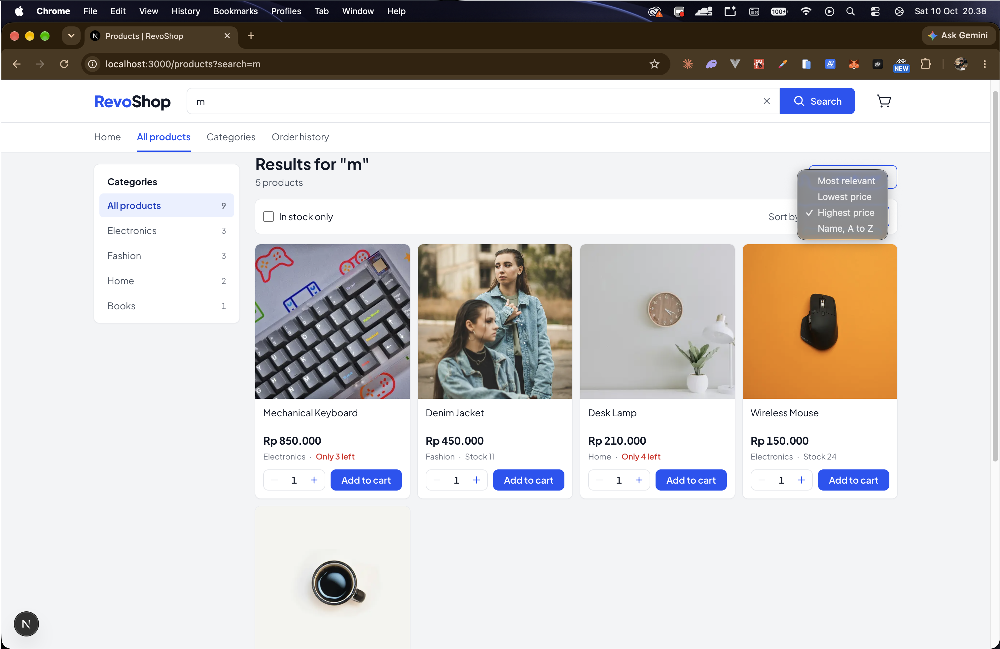
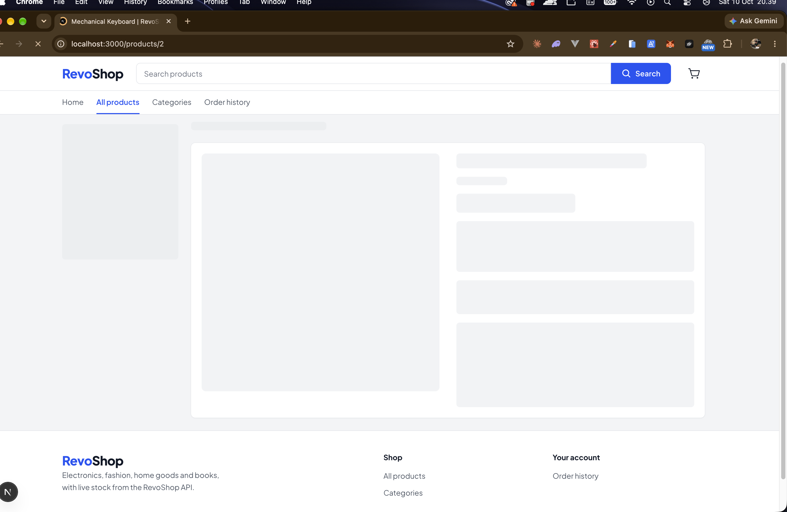
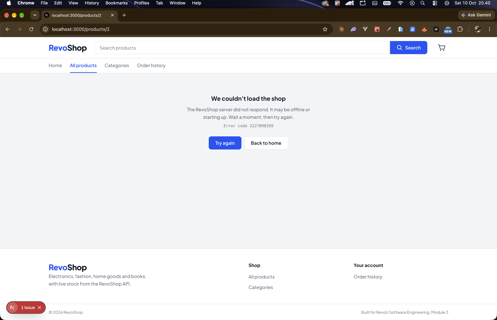

# RevoShop: Checkpoint 2

The RevoShop storefront, built with Next.js (App Router), TypeScript and Tailwind CSS.
Every page reads live data from the Flask API built in Module 2.

- **API:** https://module-2-gede-ananda.vercel.app
- **Backend repo:** https://github.com/Revou-FSSE-Jun26/module-2-GedeAnanda

## Repository

```
.
├── revoshop/               Checkpoint 2: Next.js storefront (this README)
├── html-css/               Checkpoint 1
├── javascript/             Checkpoint 1
├── typescript-tailwind/    Checkpoint 1
└── screenshots/
```

Checkpoint 1 (HTML/CSS, JavaScript, TypeScript + Tailwind) is documented in [CHECKPOINT-1.md](CHECKPOINT-1.md).

## Getting started

```bash
cd revoshop
npm install
cp .env.example .env.local   # then fill in the values
npm run dev                  # http://localhost:3000
```

### Environment variables

| Variable | Where it is used | Notes |
|---|---|---|
| `NEXT_PUBLIC_API_BASE_URL` | Every request in `lib/api.ts` | Base URL of the Flask API, no trailing slash |
| `API_AUTH_EMAIL` | `/orders` (server only) | Account used to log in, because `GET /orders` needs a JWT |
| `API_AUTH_PASSWORD` | `/orders` (server only) | Never prefixed with `NEXT_PUBLIC_`, so it never reaches the browser |

`.env.local` is ignored by git (`.env*` in `.gitignore`); only `.env.example` is committed.

## Routes

| Route | Data from the API | Files |
|---|---|---|
| `/` | `GET /products`, `GET /categories` | `page.tsx`, `loading.tsx`, `error.tsx` |
| `/products` | `GET /products?search=&category_id=`, `GET /categories` | `layout.tsx`, `page.tsx`, `loading.tsx`, `error.tsx` |
| `/products/[id]` | `GET /products/:id`, `GET /categories/:id` | `page.tsx`, `loading.tsx`, `error.tsx`, `not-found.tsx` |
| `/categories` | `GET /categories`, `GET /products` | `page.tsx`, `loading.tsx`, `error.tsx` |
| `/orders` | `POST /auth/login`, `GET /orders`, `GET /orders/:id` | `page.tsx`, `loading.tsx`, `error.tsx` |

All fetching happens in Server Components. `loading.tsx` shows a skeleton shaped like the page,
and `error.tsx` shows a friendly message with a **Try again** button.

## Project structure

```
revoshop/
├── app/                    Routes (App Router)
│   ├── layout.tsx          Root layout: <Header />, page, <Footer />, mobile tab bar, cart drawer
│   ├── page.tsx            Home: category banners, categories, 5 newest products
│   ├── products/
│   │   ├── layout.tsx      Nested layout with the category sidebar, stays mounted
│   │   ├── page.tsx        Catalog: renders <ProductGrid />
│   │   └── [id]/page.tsx   Product detail + generateMetadata
│   ├── categories/
│   └── orders/             Order history with status tabs (?status=)
├── components/             Reusable UI (all TypeScript)
│   ├── Header.tsx, HeaderSearch.tsx, NavLinks.tsx, BottomNav.tsx, Footer.tsx
│   ├── Card.tsx            Shared surface wrapper
│   ├── ProductCard.tsx     ProductCardProps, quantity counter, stock states
│   ├── ProductGrid.tsx     Category chips, sort, stock filter, cards, add-product dialog
│   ├── SearchBar.tsx, CategoryFilter.tsx, CategoryMenu.tsx, AddProductForm.tsx
│   ├── CatalogProvider.tsx Search + category state shared by header, sidebar and grid
│   ├── CartProvider.tsx    Cart state (useReducer, immutable updates)
│   ├── CartDrawer.tsx      Slide-in cart (native <dialog>) with CartSummary inside
│   └── AddedToast.tsx      "Added to cart" notice with a View cart shortcut
└── lib/
    ├── api.ts              Fetch helpers for the Flask API
    ├── types.ts            Product, Category, Order, CartItem
    ├── images.ts           Product photo lookup (image_url first, then a temporary map)
    └── format.ts           Rupiah, dates, plural labels
```

## User flow

1. **Browse:** the home page shows category banners and the newest products. Every banner and tile
   opens the catalog already filtered.
2. **Search:** the search box in the header works on every page. On `/products` it filters as you
   type; elsewhere Enter opens the results.
3. **Refine:** pick a category (sidebar on desktop, chips on phones), sort by price or name, or hide
   sold-out items.
4. **Buy:** set a quantity and press Add, on a card or on the product page (a fixed buy bar on
   phones). A notice confirms it with a **View cart** shortcut.
5. **Review the cart:** the cart drawer opens from the header (desktop) or the tab bar (phones).
   Change quantities, remove items, and see the item count and total.
6. **Orders:** order history with status tabs (All, Pending, Paid, Shipped, Completed, Cancelled).

## How the requirements are covered

**Components**
- `ProductCard` takes a `ProductCardProps` interface. Optional props (`categoryName`, `imageUrl`,
  `href`, `isActive`, `isNew`, `priority`) get defaults through destructuring.
- `Card` wraps product cards, the category menu, the product page, order rows and empty states.
- `QuantityCounter` increments and decrements between 1 and the product's stock.
- In stock shows a blue **Add to cart** button; out of stock shows a grey, disabled **Out of stock** button
  and a greyed-out photo.
- `SearchBar` is a controlled input (in the header). Typing filters the list on every keystroke, then
  after 350 ms `router.push()` writes `?search=` to the URL so the server refetches from the API.
- Category buttons write `?category=` to the URL; search and category are sent to the API together.
- Add to cart dispatches to a reducer that returns new arrays/objects (`[...state, item]`, `map`,
  `filter`). The cart drawer and the cart badge show the item count and total.
- `AddProductForm` validates name, price, stock and category, shows errors under each field, and
  appends the new product to the list (local state only, saving to the API is Checkpoint 3).

**App Router**
- The catalog page only returns `<ProductGrid />`; `<Header />` and `<Footer />` come from the root layout.
- `app/products/layout.tsx` holds the category sidebar, so moving between `/products` and
  `/products/[id]` keeps it mounted.
- `NavLinks` (desktop) and `BottomNav` (phones) use `usePathname()` to highlight the active route
  (`aria-current="page"`).
- `ProductGrid` reads the current search and category with `useSearchParams()`.
- Each route exports `metadata`; the product page uses `generateMetadata` for a title like
  `Mechanical Keyboard | RevoShop`.

## Design

- Light, marketplace-style layout: white cards on a light grey page, 8px corners, compact type.
- Colours: brand blue `#1E54F6` for buttons and links, red for low stock and sold out, green and amber
  only for order status. All text colours pass WCAG AA contrast.
- Font: [Plus Jakarta Sans](https://fonts.google.com/specimen/Plus+Jakarta+Sans), loaded with `next/font`.
- Icons: [Phosphor Icons](https://phosphoricons.com) (`@phosphor-icons/react`), used only where they
  do a job (search, cart, tab bar, quantity buttons, close, remove).
- Phones get a bottom tab bar, a fixed buy bar on product pages, and a full-height cart drawer.

## Screenshots

Taken locally with `npm run dev` against the live API.

### Home: 5 products from the API


### Live search on /products
The list filters while typing and the URL updates to `?search=mo`.


### Search with category filter
Search and category are sent to the API together (`?search=&category=`).


### Search with sort


### Product detail with dynamic title
The browser tab shows `Mechanical Keyboard | RevoShop`.


### Categories and active nav link


### Cart summary


### loading.tsx


### error.tsx
Triggered by pointing `NEXT_PUBLIC_API_BASE_URL` at an unreachable server.


## Notes

- Product photos are free-license photos from [Unsplash](https://unsplash.com). The API has no image
  field yet, so `lib/images.ts` matches the seeded products by name. When the API returns
  `image_url`, that value is used first and the map can be deleted. Products without a photo show a
  plain "No photo" placeholder.
- Checkout is not built yet; placing orders through the API is part of Checkpoint 3.
- Prices are formatted as Indonesian rupiah.
