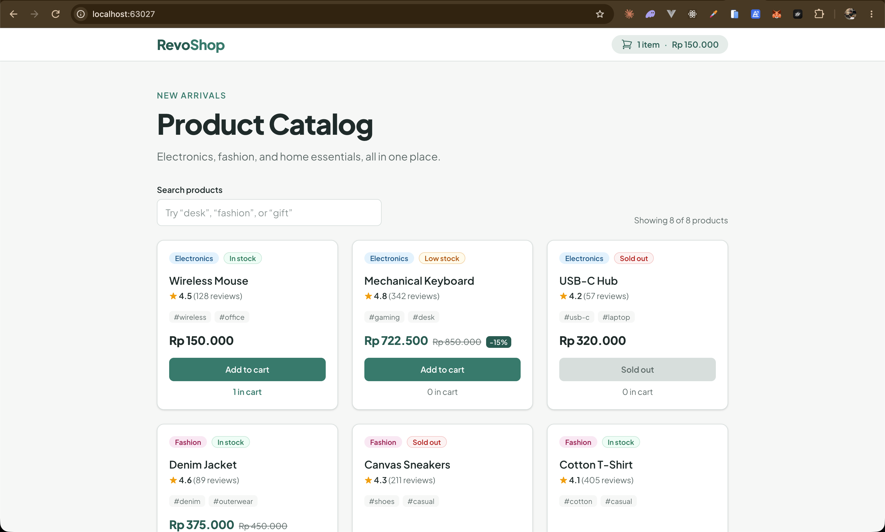

# RevoShop — Checkpoint 1: Web Fundamentals

Fundamentals practice before building RevoShop with Next.js: semantic HTML, CSS layout,
vanilla JavaScript, TypeScript, and Tailwind CSS.

## Project structure

```
.
├── html-css/               Semantic profile page with contact form
├── javascript/
│   ├── dom-events/         DOM manipulation & event handling (task list)
│   └── array-methods/      forEach, map, filter, reduce (product inventory)
├── typescript-tailwind/    Typed, interactive product catalog
├── revoshop/               Checkpoint 2: Next.js storefront (see revoshop/README.md)
└── screenshots/
```

## 1. `html-css/` — Profile page

A personal profile page built with semantic HTML5 (`header`, `nav`, `main`, `section`,
`article`, `footer`) and a contact form with labeled inputs.

- CSS Grid for the skills, projects, and contact form layouts; Flexbox for the header
- Mobile-first styles with a breakpoint at `768px`
- CSS custom properties and `box-sizing: border-box`

**Run:** open `html-css/index.html` in a browser.

## 2. `javascript/` — Vanilla JavaScript exercises

### `dom-events/` — Task list
- Selects and updates elements, toggles classes (`is-done`), creates and removes list items
- Handles `submit`, `click`, and `input` events, with `preventDefault()` on the form
- Input validation with an inline error message

### `array-methods/` — Product inventory
- `filter`: filter by category and stock
- `map`: transform raw data into display-ready rows
- `reduce`: totals, average price, inventory value, and a count-per-category object
- `forEach`: render table rows and dropdown options

**Run:** open `index.html` inside each folder in a browser.

## 3. `typescript-tailwind/` — Typed product catalog

The direct predecessor of the React `ProductCard` in Checkpoint 2.

- **TypeScript** (`tsc` + strict `tsconfig.json`): interfaces (`Product`, `Rating`, `CartItem`),
  union types (`Category`, `StockStatus`), and a discriminated union (`Discount`)
- **Tailwind CSS v4**: configured in `src/input.css` via `@theme`, utility classes only,
  mobile-first grid (`grid-cols-1 sm:grid-cols-2 lg:grid-cols-3`)
- Typed data mapped to Tailwind classes with `Record<StockStatus, string>`
- Live search (name, category, tags) and an add-to-cart counter with stock limits

**Requirements:** Node.js (v20 or newer recommended)

```bash
cd typescript-tailwind
npm install
npm run dev        # watch TypeScript + Tailwind and serve at http://localhost:3000
```

Other scripts:

```bash
npm run build      # compile TypeScript and build minified CSS into dist/
npm run serve      # serve the built output only
```

> The page loads `dist/main.js` as an ES module, so it must be opened through a local
> server (`http://localhost`), not by double-clicking `index.html` (`file://`).

## Screenshots

### Profile page — desktop


### Profile page — mobile


### Product catalog — live search and cart
